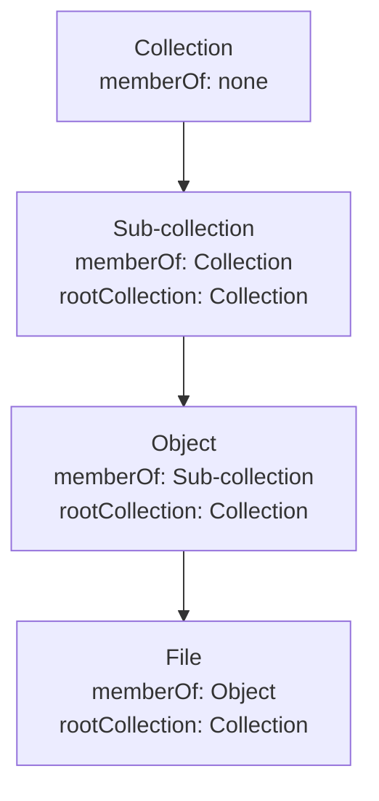

import { Code } from '@astrojs/starlight/components';
import entitiesLocation from '@examples/concepts/entities-location.ts?raw';

Everything arocapi serves is an **entity**: a thing described in an RO-Crate, identified by a URL. A repository is a
tree of entities, usually three kinds deep, plus the people and organisations those entities refer to.

| Kind | Typical `entityType` | What it is |
| --- | --- | --- |
| Collection | `http://pcdm.org/models#Collection` | A grouping, such as a corpus, a project or a sub-collection. |
| Object | `http://pcdm.org/models#Object` | One item in a collection, such as a recording session or a document. |
| File | `http://schema.org/MediaObject` | A file belonging to an object, with bytes you can download. |
| Person | `http://schema.org/Person` | Someone an entity refers to, such as a speaker, a depositor or a collector. |
| Organisation | `http://schema.org/Organization` | A body an entity refers to, such as a funder or the holding archive. |

The types come from the [Portland Common Data Model](https://pcdm.org) and [schema.org](https://schema.org), as used in
RO-Crate. arocapi stores `entityType` as a string and doesn't check it, so you can index other types, such as places,
alongside these.

## People and organisations

An RO-Crate describes the people and organisations behind its data, and you can index them as entities in their own
right. A speaker who appears in many recordings then has one id, one Record and one page in your portal, rather than a
name repeated in each crate.

They behave like any other entity. They have a Record and Metadata but no Content, because they have no row in the File
table. They sit outside the membership tree, or under the collection that describes them, as you choose when indexing.
`GET /entities?entityType=http://schema.org/Person` lists them, and the [visibility filters](/configuration/visibility/)
apply to them as to anything else, which matters when a person's details are sensitive.

## Membership

Two fields place an entity in the tree. Both hold entity ids, and both are empty on a top-level collection.

- `memberOf` is the entity's parent: the collection an object belongs to, or the object a file belongs to.
- `rootCollection` is the top-level collection the entity sits under, however deep it is.

You walk the tree one level at a time by listing members:

- [`GET /entities?memberOf=<id>`](/reference/routes/#get-entities) lists the entities whose parent is `<id>`. Add
  `entityType` (comma-separated) to keep only some types.
- [`GET /files?memberOf=<id>`](/reference/routes/#get-files) lists the files of an object, with their filename, media
  type and size.

In every entity response, arocapi replaces the `memberOf` and `rootCollection` ids with `{ id, name }`, so a client
can show a breadcrumb without another request. A parent that isn't in the database comes back as `null`.

<Code code={entitiesLocation} lang="ts" />

## File entities

A file is an entity like any other, with a [Record](/concepts/record-metadata-content/#record) listed by `/entities` and
its own RO-Crate metadata. It also has a row in the File table with the same id, holding its `filename`, `mediaType` and
`size`. That row is what gives it Content, the bytes served by `/file/:id`. Only file entities have Content. Both rows
also have a `meta` column for your own data, such as storage locations; see [Entity meta](/reference/entity-meta/).

## Licences

Every entity carries two licence ids: `metadataLicenseId` governs who may read its full RO-Crate metadata, and
`contentLicenseId` governs who may download its Content. See [Licences & authorisation URLs](/concepts/licences/).

## Membership and visibility

Membership doesn't cascade anything. Hiding a collection doesn't hide its objects and files, because each entity is
filtered on its own. If a whole collection should be hidden, filter on `rootCollection` or `memberOf` in your
[visibility filters](/configuration/visibility/). See [Visibility vs Access](/concepts/visibility-vs-access/) for how
hidden entities behave. A visible entity still shows its parent's name, even when the parent itself is hidden from the
request.
