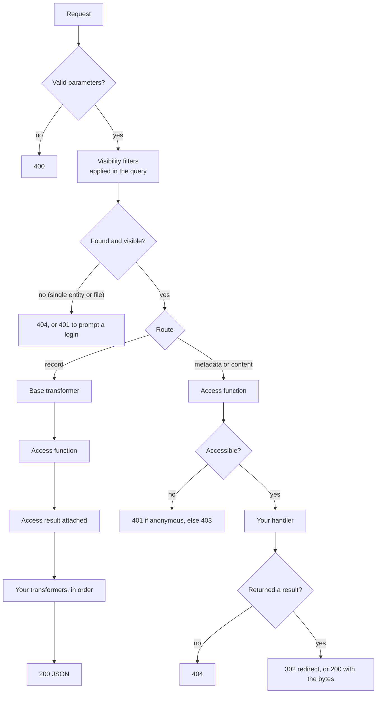

import { Code } from '@astrojs/starlight/components';
import requestLifecycleTransformer from '@examples/concepts/request-lifecycle-transformer.ts?raw';

Every route runs your code in a fixed order. Knowing it tells you what each hook can rely on: an access function never
sees a Hidden entity, a handler never runs for a Denied request, and a transformer always sees the access result.
[Visibility vs Access](/concepts/visibility-vs-access/#how-a-request-is-decided) covers the outcomes; this page covers
where your code runs.

Routes come in two shapes. **Record routes** (`/entities`, `/entity/:id`, `/files` and `/search`) return entities and
files as JSON and run your transformers. **Metadata and Content routes** (`/entity/:id/metadata` and `/file/:id`,
`GET` and `HEAD`) enforce access and hand over to your handlers.

## Validation

Fastify checks the path, query and body against each route's schema before arocapi's code runs. An invalid request,
such as an entity id that isn't a URL or a `limit` over 1000, gets a `400` and none of your hooks are called.

## Visibility

arocapi calls your `entityVisibilityFilter` and adds its result to the database query with `AND`. On `/search` it also
calls `searchVisibilityFilter` and adds it as a filter on the OpenSearch query, then reloads the hits from the database
with the entity filter. Hidden entities are never loaded, so nothing after this step can see them, and totals and
facets already exclude them.

For a single entity or file that isn't found, arocapi answers `404`. If you set
[`promptLoginForHidden`](/configuration/visibility/#promptloginforhidden), it first asks
`isAuthenticated`, and answers `401` instead when the request is anonymous and the entity exists. For `/file/:id`,
visibility is that of the file's entity.

## Record routes

For each visible entity, arocapi:

1. Builds the base entity from the database row: id, type, name, description, licence ids, and `memberOf` and
   `rootCollection` as ids. This is what your `access` function receives, so access decisions never wait on parent
   lookups.
2. Calls your `access` function with it, and in parallel replaces `memberOf` and `rootCollection` with `{ id, name }`.
3. Attaches the access result as `access`. Only the boolean flags and non-empty authorisation URLs are kept.
4. Runs your [`entityTransformers`](/configuration/transformers/#entitytransformers) one after another, each receiving
   the previous one's output.

Record routes don't enforce access. A Denied entity is still listed, with `access.metadata` or `access.content` set to
`false`.

Files follow the same steps with `fileTransformers`: the access function is called with the file's entity, and the
file's `access` keeps only `content` and `contentAuthorizationUrl`. On `/search`, arocapi adds `searchExtra` (score and
highlights) after your transformers have run.

Transformers can rely on `access` being present:

<Code code={requestLifecycleTransformer} lang="ts" />

## Metadata and Content routes

For `/entity/:id/metadata` and `/file/:id`, arocapi:

1. Calls your `access` function with the base entity (for a file, its file entity) and checks `metadata` or `content`
   respectively.
2. If that is `false`, the request is Denied. arocapi asks [`isAuthenticated`](/configuration/access/#isauthenticated)
   and answers `401` for an Anonymous request or `403` otherwise. Without `isAuthenticated`, every Denied request gets
   `403`. Your handler isn't called.
3. Otherwise calls [`roCrateHandler` or `fileHandler`](/configuration/handlers/) (`get` or `head`). Your handler can
   assume the request is allowed.
4. If the handler returns `false`, answers `404`. Otherwise sends a `302` redirect, or a `200` with the stream, the file
   or an nginx `X-Accel-Redirect`, as described in [Storage](/strategies/storage/).

These routes don't run transformers: their bodies are your RO-Crate metadata or file bytes, not entity JSON.

## Where your code runs

| Hook | Runs on | Receives | Can rely on |
| --- | --- | --- | --- |
| `entityVisibilityFilter` | every route except `/capabilities` | the request context | nothing yet |
| `searchVisibilityFilter` | `/search` | the request context | nothing yet |
| `isAuthenticated` | refusals: Denied, and hidden with `promptLoginForHidden` | the request context | nothing yet |
| `access` | every route except `/capabilities` | the base entity and the request context | the entity is visible |
| `roCrateHandler`, `fileHandler` | metadata and file routes | the Entity or File row, including `meta` | the entity is visible and accessible |
| `entityTransformers` | `/entities`, `/entity/:id`, `/search` | the entity with `access` attached | the entity is visible |
| `fileTransformers` | `/files` | the file with `access` attached | the file's entity is visible |

Every hook receives the same [request context](/configuration/transformers/#request-context), `{ request, fastify }`, so
whatever your authentication sets on the request is available throughout.
