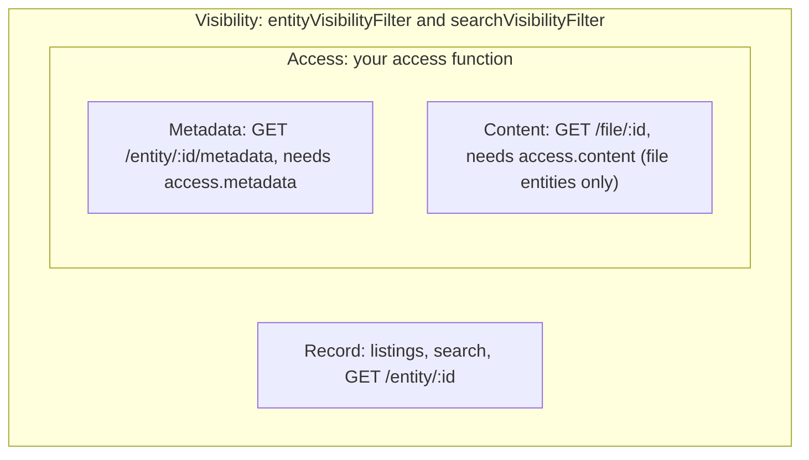
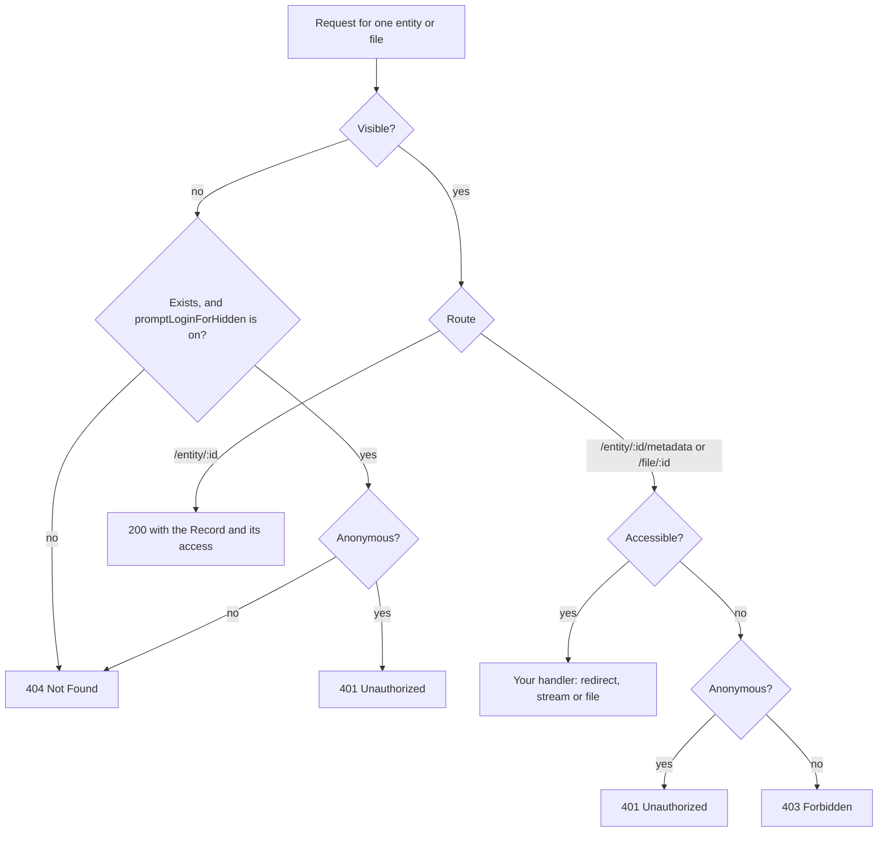

arocapi asks two questions about every entity a request touches, always in the same order.

1. **Is it visible?** Your visibility filters decide which entities exist for this request. A **Visible** entity
   appears in listings and search and can be looked up. A **Hidden** one behaves exactly like an entity that was
   never there.
2. **Is it accessible?** For a visible entity, your access function decides whether this request may read its
   [Metadata and Content](/concepts/record-metadata-content/). If it may, the request is **Accessible**; if not, it
   is **Denied**.

A request is **Anonymous** when it carries no valid credentials, as decided by your `isAuthenticated` function.
If you don't supply `isAuthenticated`, the repository has no logins, so no request is anonymous.

## Three levels, two guards

Visibility guards the whole entity, including its Record. Access sits inside it and guards only Metadata and
Content.



## How a request is decided

For a single entity or file, arocapi runs these checks before your handler sees anything.



### Hidden is 404, unless you prompt a login

By default a hidden entity gets the same 404, with the same error code and message, as an id that doesn't exist.
A client can't tell them apart, so hiding an entity reveals nothing about it.

Some repositories would rather tell an anonymous visitor to log in, because the entity may well be visible once
they do. Set `promptLoginForHidden: true` (which requires `isAuthenticated`) and an anonymous request for a hidden
entity that exists gets a 401 instead. Ids that don't exist still get a 404, and logged-in requests for hidden
entities still get a 404. The trade-off is that an anonymous client can now tell that something exists at an id.

A hidden entity never gets a 403. That would confirm the entity exists to someone who isn't allowed to know.

### Denied is 401 or 403, never 404

A Denied request is for an entity the request can already see, so there's nothing to hide by pretending it's
missing. arocapi answers in a way the client can act on:

- **401 Unauthorized** when the request is anonymous. Logging in might grant access, so the client should prompt
  for it.
- **403 Forbidden** when the request is logged in, or the repository has no logins. Logging in again won't help;
  the user needs to be granted access. Your access function can return an authorisation URL telling them where to
  ask for it.

In both cases your handler isn't called, so a Denied request never learns a redirect location or file path.

## Route by route

| Route                                 | Hidden                                                       | Visible and Accessible                                                                                                  | Visible and Denied, Anonymous                                         | Visible and Denied, logged in                                         |
| ------------------------------------- | ------------------------------------------------------------ | ----------------------------------------------------------------------------------------------------------------------- | --------------------------------------------------------------------- | --------------------------------------------------------------------- |
| `GET /entities`                       | Left out of the results and `total`                          | Listed, with `access` flags true                                                                                        | Listed, with `access` flags false                                     | Listed, with `access` flags false                                     |
| `GET /files`                          | Left out of the results and `total`                          | Listed, with `access.content` true                                                                                      | Listed, with `access.content` false                                   | Listed, with `access.content` false                                   |
| `POST /search`                        | Left out of the results, `total` and facets                  | Listed, with `access` flags true                                                                                        | Listed, with `access` flags false                                     | Listed, with `access` flags false                                     |
| `GET /entity/:id`                     | 404, or 401 if Anonymous and `promptLoginForHidden` is on    | 200 with the Record                                                                                                     | 200 with the Record, `access` flags false                             | 200 with the Record, `access` flags false                             |
| `GET`, `HEAD /entity/:id/metadata`    | 404, or 401 if Anonymous and `promptLoginForHidden` is on    | `roCrateHandler` runs: `GET` gives a 302 redirect or 200 with `application/ld+json`; `HEAD` gives 200 with headers      | 401                                                                   | 403                                                                   |
| `GET`, `HEAD /file/:id`               | 404, or 401 if Anonymous and `promptLoginForHidden` is on    | `fileHandler` runs: `GET` gives a 302 redirect (200 with `{ "location" }` with `?noRedirect=true`) or 200 with the bytes; `HEAD` gives 200 with headers | 401                                                                   | 403                                                                   |

Some details the table leaves out:

- An id that doesn't exist is always a 404, on every single-entity route, whatever the request.
- `GET /file/:id` for a collection or object is a 404: only file entities have Content.
- In listings and search, Denied entities are listed like any other. "Denied" only shows in their `access` flags,
  and in an authorisation URL if your access function supplies one.
- `GET /entity/:id` never consults access to decide the response. It always returns the Record of a visible entity.
- If your handler returns `false`, the response is a 404.
- A repository without `isAuthenticated` has no Anonymous requests, so every Denied request is a 403.
- `GET /capabilities` describes the API itself and involves no entities, so neither guard applies.

## A worked scenario

A repository holds one public collection with two items:

- **Field recordings**, a collection whose metadata and content are both under an open licence.
- **Ceremony songs**, an item in the collection. Its metadata is open, but its content is under a closed licence,
  as is its one file, **song.wav**.
- **Unreviewed deposit**, an item that hasn't been published yet, with its file **draft.wav**. Both are hidden.

Three people use it:

- an **anonymous** visitor, with no credentials;
- **Alice**, who has logged in but doesn't hold the closed licence;
- **Bob**, who has logged in and holds the closed licence.

The repository is configured like this:

```ts twoslash
type User = { licences: string[] };
declare function currentUser(request: import('arocapi').RequestContext['request']): User | undefined;
// ---cut---
import { LicenceAccess, type Options } from 'arocapi';

const openLicence = 'https://creativecommons.org/licenses/by/4.0/';

const guards = {
  entityVisibilityFilter: () => ({ meta: { path: '$.published', equals: true } }),
  searchVisibilityFilter: () => ({ term: { 'meta.published': true } }),
  isAuthenticated: ({ request }) => currentUser(request) !== undefined,
  access: LicenceAccess({
    hasLicence: (licenceId, { request }) =>
      licenceId === openLicence || (currentUser(request)?.licences.includes(licenceId) ?? false),
    authorisationUrl: (licenceId) => `https://rems.example.org/apply?licence=${encodeURIComponent(licenceId)}`,
  }),
} satisfies Partial<Options>;
```

Each entity carries its own `published` flag. Visibility filters don't cascade: hiding an item doesn't hide its
files, so **draft.wav** needs the flag as well. `currentUser` stands in for however your app reads the logged-in
user from the request.

Here's what each request gets:

| Request                                         | Anonymous                                                    | Alice                                                        | Bob                                            |
| ----------------------------------------------- | ------------------------------------------------------------ | ------------------------------------------------------------ | ---------------------------------------------- |
| `GET /entities?memberOf=` Field recordings      | `total: 1`, Ceremony songs with `content: false` and a `contentAuthorizationUrl` | Same as anonymous                                            | `total: 1`, Ceremony songs with `content: true` |
| `GET /files?memberOf=` Ceremony songs           | `total: 1`, song.wav with `content: false` and a `contentAuthorizationUrl`       | Same as anonymous                                            | `total: 1`, song.wav with `content: true`       |
| `POST /search` for everything                   | `total: 3`: the collection, Ceremony songs and song.wav; facets count those three | Same as anonymous                                            | Same, with `content: true` on Ceremony songs and song.wav |
| `GET /entity/:id` Ceremony songs                | 200 with the Record                                          | 200 with the Record                                          | 200 with the Record                            |
| `GET /entity/:id/metadata` Ceremony songs       | Your `roCrateHandler` runs                                   | Your `roCrateHandler` runs                                   | Your `roCrateHandler` runs                     |
| `GET /file/:id` song.wav                        | 401                                                          | 403                                                          | Your `fileHandler` runs                        |
| `GET /entity/:id` Unreviewed deposit            | 404                                                          | 404                                                          | 404                                            |
| `GET /entity/:id/metadata` Unreviewed deposit   | 404                                                          | 404                                                          | 404                                            |
| `GET /file/:id` draft.wav                       | 404                                                          | 404                                                          | 404                                            |

Following it through:

1. **Listing and search.** Everyone sees the same entities, because visibility doesn't depend on who you are here.
   The Unreviewed deposit and draft.wav are missing from the results, from `total` and from the facets, so nobody
   learns they exist. Ceremony songs and song.wav are listed for everyone. Only their `access` differs: Bob holds
   the closed licence, so `content` is true for him; for the others it's false, with a link to apply for it.
2. **The Record.** `GET /entity/:id` for Ceremony songs returns its Record to all three. The Record is guarded only
   by visibility, so a closed licence on the content doesn't stop anyone reading the item's name and description.
3. **Metadata.** The item's metadata licence is open, so all three reach your `roCrateHandler` and get the full
   RO-Crate.
4. **Content.** The closed licence applies here. The anonymous visitor gets a 401: logging in might help, so the
   client can prompt for it. Alice is logged in and still lacks the licence, so she gets a 403 and can follow the
   authorisation URL from the Record to apply. Bob reaches your `fileHandler`.
5. **The hidden draft.** Every route answers 404, exactly as for an id that was never used. Not even its existence
   leaks.

If you turn on `promptLoginForHidden`, only the anonymous column changes: the three requests for the Unreviewed
deposit and draft.wav get a 401 instead of a 404, inviting the visitor to log in. Alice and Bob still get a 404,
because they can't see drafts either.

## Hidden entities stay hidden everywhere

Visibility is applied as a filter inside every query, not by removing entities from a page after the fact. That's
what keeps hidden entities out of every count: `total` on `/entities`, `/files` and `/search`, pagination, and
search facets are all computed over visible entities only. Paging through results never turns up a short page
because something hidden was dropped from it.

### Why the two filters must agree

You supply visibility twice, because arocapi reads from two places:

- `entityVisibilityFilter` is a Prisma `where` condition, used for listings, single-entity routes, and to reload
  search hits from the database.
- `searchVisibilityFilter` is an OpenSearch query, used for search results, `total` and facets.

Both must describe the same set of entities for every request. arocapi applies each one where it reads, but it
can't check that they agree. If they don't:

- **Search is looser than the database.** OpenSearch counts entities the database filter hides. arocapi drops those
  hits when it reloads them, so the entities themselves don't leak, but `total` and the facet counts include them
  and pages come back short.
- **Search is stricter than the database.** Entities a request can open with `GET /entity/:id` never turn up in
  search.

The simplest way to keep them in step is to index the fields your visibility depends on alongside each entity, as
the `published` flag is in the scenario above, and write both filters against the same field.
