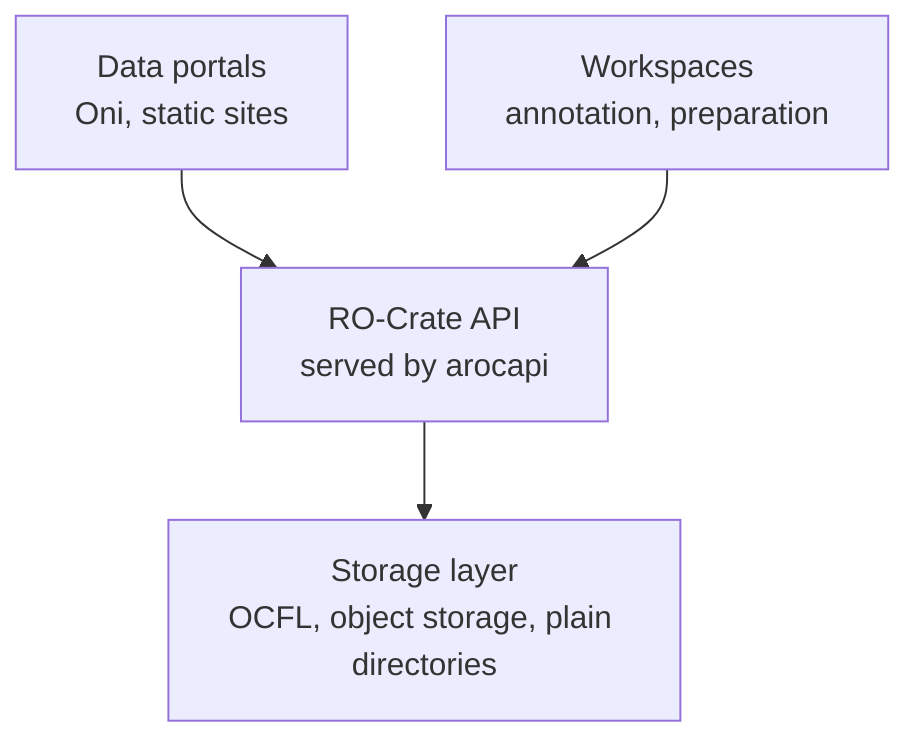

arocapi is part of [CrateWorks](https://crate-works.org), a workbench of open-source tools for research data described
with [RO-Crate](https://www.researchobject.org/ro-crate/). Every tool in it reads or writes RO-Crates, so you can
combine them at whichever stage of the data journey you need.

## The layers

CrateWorks splits a repository into layers, and arocapi is the API layer in the middle:

- **Storage layer.** Your RO-Crates live somewhere durable: an [OCFL](https://ocfl.io) store, object storage or a
  plain directory tree. arocapi doesn't prescribe one. You write handlers that fetch metadata and files from it, as
  described in [Storage](/strategies/storage/).
- **API layer.** The [RO-Crate API](https://ro-crate-api.crate-works.org) is an implementation-neutral HTTP
  specification for discovering and reading RO-Crate archives, so the same client can talk to any conforming
  repository. arocapi is a reference implementation of it that you mount in your own Fastify app.
- **Portals and workspaces.** Clients use the API to browse, search and download. They don't need to know how the
  repository stores its data.

## Related tools

| Tool | What it is | How it relates to arocapi |
| --- | --- | --- |
| [RO-Crate API](https://ro-crate-api.crate-works.org) | The HTTP specification for serving RO-Crate archives. | arocapi implements it. |
| [Oni](https://github.com/crate-works/oni) | A configuration-driven discovery portal for RO-Crate archives. | Browses and searches any arocapi-backed repository. |
| [Collection Downloader](https://github.com/crate-works/downloader) | Picks files across a collection and emails a zip. | Another client for RO-Crate collections. |
| [RaspboCrate](https://raspbocrate.crate-works.org) | A field catalogue manager on a Raspberry Pi. | Bundles an RO-Crate API with plain-directory storage. |
| [Bowerbird](https://bowerbird.crate-works.org) | Browses an RO-Crate archive from `index.html`, with no server. | An alternative for offline or cold storage, where no API runs. |
| [RO-Crate Static Site](https://crate-works.github.io/ro-crate-static-site/) | Builds a static website from an RO-Crate. | Publishes a single crate without an API. |
| [Cockatiel](https://github.com/crate-works/cockatiel) | Local-first audio annotation in the browser. | A workspace tool that produces data you might archive. |

The full list, with the projects behind them, is on the [CrateWorks workbench](https://crate-works.org/#workbench).

arocapi is designed around the [PILARS](/introduction/pilars/) protocols for long-term archival repositories.
