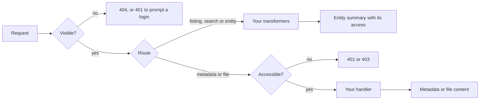

import { Code } from '@astrojs/starlight/components';
import whatIsArocapiOptions from '../../../../examples/introduction/what-is-arocapi-options.ts?raw';

arocapi is a library that implements an RO-Crate API, and part of [CrateWorks](/introduction/crate-works/). It is a
[Fastify](https://fastify.dev) plugin, so you register it in your own app (or in an Express app through Fastify), and
it adds routes for listing, searching and reading the [entities](/concepts/entities/) in a repository: collections,
objects and files, each described by RO-Crate metadata.

It is built for long-term archival repositories that follow the [PILARS](/introduction/pilars/) protocols. arocapi
owns the API and leaves the decisions that differ between repositories to you:

- **Where things live.** Entities are indexed in a database through Prisma and searched with
  [OpenSearch](/strategies/search/). You supply handlers that fetch RO-Crate metadata and file bytes from
  [your storage](/strategies/storage/).
- **Who sees what.** Visibility filters decide which entities exist for a request. An access function decides
  whether a request may read an entity's full metadata and its file content, usually by
  [licence](/concepts/licences/). See [Visibility vs Access](/concepts/visibility-vs-access/).
- **What responses look like.** Transformers can add fields to every entity and file the API returns.

## Registering the plugin

You pass everything arocapi needs as plugin options.

<Code code={whatIsArocapiOptions} lang="ts" />

Every option is described under Configuration: [data sources](/configuration/data-sources/),
[visibility](/configuration/visibility/), [access](/configuration/access/), [handlers](/configuration/handlers/),
[search](/configuration/search/), [transformers](/configuration/transformers/) and [HTTP](/configuration/http/). The
routes it adds are listed under [Routes](/reference/routes/).

## How a request is handled

Every request passes the same checks in the same order, and your code runs at each step. The
[request lifecycle](/concepts/request-lifecycle/) covers it in detail. An entity hidden from a
request doesn't exist as far as that request is concerned. Its summary appears in listings, search and entity
responses whenever it is visible, but reading its full metadata or a file's content also needs access.
[Record, Metadata, Content](/concepts/record-metadata-content/) describes these levels, and
[Visibility vs Access](/concepts/visibility-vs-access/) shows what each route returns.

To set up your own, start with [Install](/getting-started/install/).
