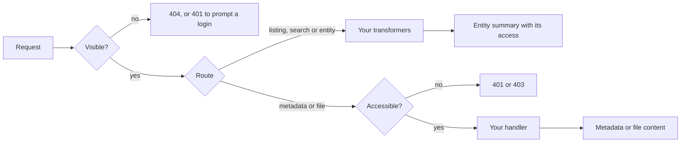

arocapi is a library that implements an RO-Crate API. It is a [Fastify](https://fastify.dev) plugin, so you register it
in your own app (or in an Express app through Fastify), and it adds routes for listing, searching and reading the
entities in a repository: collections, objects and files, each described by RO-Crate metadata.

It is built for long-term archival repositories that follow the
[PILARS](https://w3id.org/ldac/pilars) protocols. arocapi owns the API and leaves the decisions that differ between
repositories to you:

- **Where things live.** Entities are indexed in a database through Prisma and searched with OpenSearch. You supply
  handlers that fetch RO-Crate metadata and file bytes from your storage.
- **Who sees what.** Visibility filters decide which entities exist for a request. An access function decides
  whether a request may read an entity's full metadata and its file content.
- **What responses look like.** Transformers can add fields to every entity and file the API returns.

## Registering the plugin

You pass everything arocapi needs as plugin options. Hover over the names to see their types.

```ts twoslash
declare const prisma: import('arocapi').Options['prisma'];
declare const opensearch: import('arocapi').Options['opensearch'];
declare const fileHandler: import('arocapi').FileHandler;
declare const roCrateHandler: import('arocapi').RoCrateHandler;
// ---cut---
import {
  AllPublicAccess,
  AllVisibleEntityFilter,
  AllVisibleSearchFilter,
  type Options,
} from 'arocapi';

const options: Options = {
  prisma,
  opensearch,
  fileHandler,
  roCrateHandler,
  entityVisibilityFilter: AllVisibleEntityFilter,
  searchVisibilityFilter: AllVisibleSearchFilter,
  access: AllPublicAccess,
};
```

## How a request is handled

Every request passes the same checks in the same order, and your code runs at each step. An entity hidden from a
request doesn't exist as far as that request is concerned. Its summary appears in listings, search and entity
responses whenever it is visible, but reading its full metadata or a file's content also needs access.


