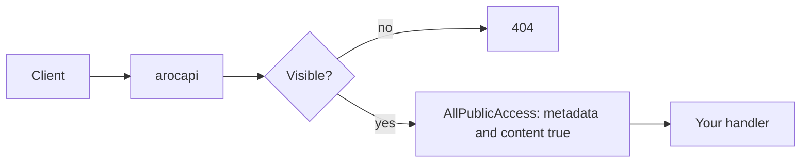
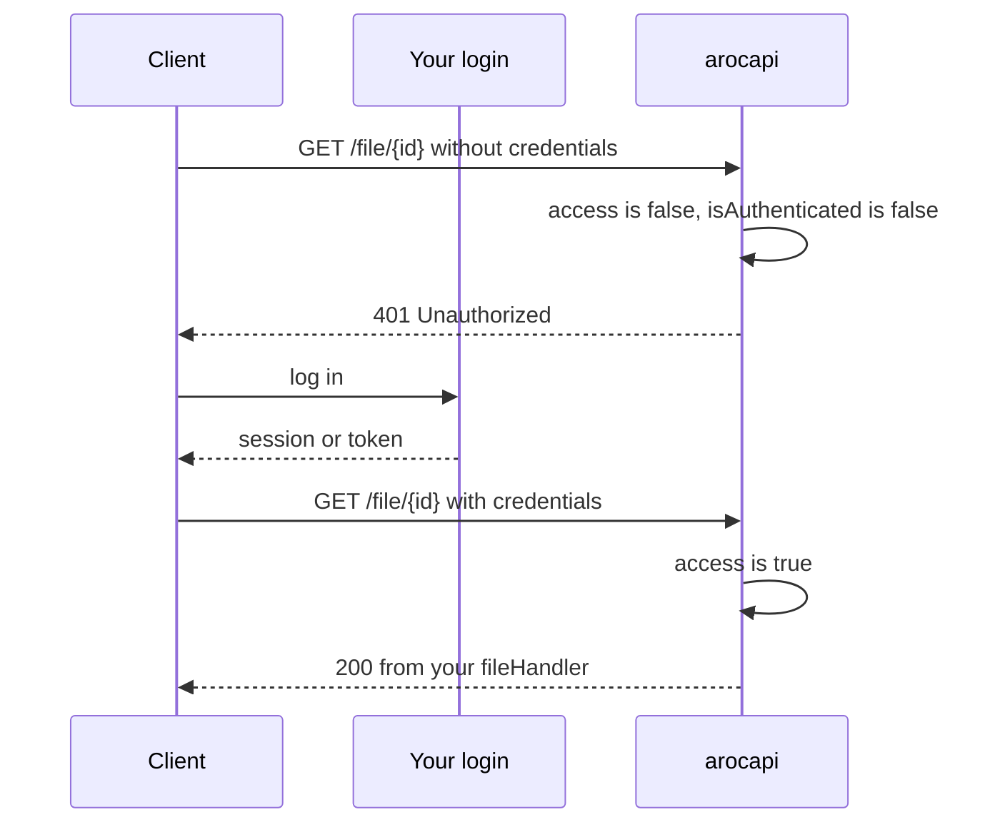
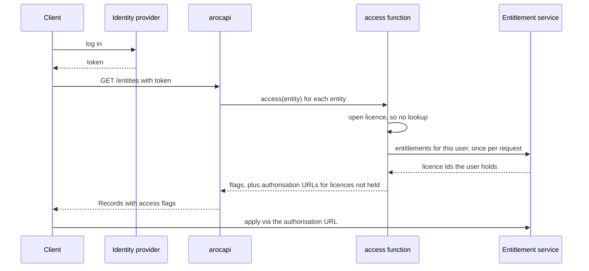

Your `access` function decides, for each visible entity, whether a request may read its
[Metadata and Content](/concepts/record-metadata-content/). arocapi attaches the answer to every Record and enforces it
on `/entity/:id/metadata` and `/file/:id`. An optional `isAuthenticated` function tells arocapi which requests are
anonymous, which decides whether a Denied request gets a 401 or a 403. How those answers play out route by route is
covered in [Visibility vs Access](/concepts/visibility-vs-access/), and the options themselves in
[Configuration → Access](/configuration/access/).

This page describes three common ways to make those decisions. They differ in how much your API has to know about the
user:

| Pattern | Who the user is | What arocapi asks | Denied requests |
| --- | --- | --- | --- |
| [Open repository](#open-repository) | Doesn't matter | Nothing | Never happen |
| [Logged-in only](#logged-in-only) | Your login | Is anyone logged in? | 401, prompting a login |
| [Licence checks](#licence-checks-against-an-external-authority) | An identity provider | Does this user hold the entity's licence? | 401 if anonymous, otherwise 403 with an authorisation URL |

The access function receives the entity's Record fields, including `metadataLicenseId`, `contentLicenseId`,
`memberOf` and `rootCollection` (as ids), and the request context. arocapi doesn't look up parents for it, so an
entity's own fields have to carry everything the decision needs.

## Open repository

Everything visible can be read by anyone. There are no logins, and the access function says yes to every entity.



arocapi exports `AllPublicAccess` for this. Leave out `isAuthenticated`: without it no request is anonymous, and with
this access function no request is Denied either.

```ts twoslash
import { AllPublicAccess, AllVisibleEntityFilter, AllVisibleSearchFilter, type Options } from 'arocapi';

export const guards = {
  entityVisibilityFilter: AllVisibleEntityFilter,
  searchVisibilityFilter: AllVisibleSearchFilter,
  access: AllPublicAccess,
} satisfies Partial<Options>;
```

**With visibility.** An open repository can still keep entities out of sight. Access only covers what is visible, so
drafts, withdrawn items or anything else you don't want to publish belong in the visibility filters, not in the access
function. Replace `AllVisibleEntityFilter` and `AllVisibleSearchFilter` with filters that leave those entities out, and
they return 404 everywhere while everything else stays open.

## Logged-in only

Anyone who logs in may read everything. Anonymous visitors can browse Records, but asking for Metadata or Content gets
a 401, which tells the client to send them to log in.



Your app authenticates the request however it already does, for example with a session cookie or a bearer token
checked in a Fastify hook. Both functions then read the result from the request. Here `currentUser` stands in for
that:

```ts twoslash
type User = { id: string };
declare function currentUser(request: import('arocapi').RequestContext['request']): User | undefined;
// ---cut---
import type { AccessFunction, IsAuthenticated } from 'arocapi';

export const isAuthenticated: IsAuthenticated = ({ request }) => currentUser(request) !== undefined;

export const access: AccessFunction = (_entity, { request }) => {
  const loggedIn = currentUser(request) !== undefined;

  return { metadata: loggedIn, content: loggedIn };
};
```

[`isAuthenticated`](/configuration/access/#isauthenticated) is what turns the refusal into a 401. Without it, arocapi treats every request as logged in and
answers 403, which a client can't act on.

A common variation opens the Metadata to everyone and asks for a login only for Content. Return `metadata: true` and
keep `content: loggedIn`.

**With visibility.** In this pattern anonymous visitors still see Records in listings and search, with `access` flags
false. If anonymous visitors shouldn't see anything at all, hide everything from them through visibility instead:

```ts twoslash
type User = { id: string };
declare function currentUser(request: import('arocapi').RequestContext['request']): User | undefined;
// ---cut---
import type { Options } from 'arocapi';

export const guards = {
  entityVisibilityFilter: ({ request }) => (currentUser(request) ? {} : { id: { in: [] } }),
  searchVisibilityFilter: ({ request }) => (currentUser(request) ? { match_all: {} } : { match_none: {} }),
  promptLoginForHidden: true,
} satisfies Partial<Options>;
```

Listings and search come back empty for anonymous requests. With [`promptLoginForHidden`](/configuration/visibility/#promptloginforhidden), a direct request for an
entity that exists gets a 401 rather than a 404, so links shared with colleagues still lead to a login.

## Licence checks against an external authority

Each entity carries a metadata licence and a content licence. A user may read the Metadata if they hold the metadata
licence, and the Content if they hold the content licence. Who holds which licence is decided outside your API, by an
entitlement service such as [REMS](https://github.com/CSCfi/rems), where users apply for access and data stewards
approve it.



The parts are:

- **An identity provider** establishes who the user is, for example through OpenID Connect. Your app validates the
  token and puts the user on the request.
- **An entitlement service** lists the licences that user holds.
- **Always-open licences**, such as a Creative Commons licence, are granted without asking the entitlement service, so
  anonymous requests and most of a public collection cost no lookups.
- **A per-request cache** means a listing of a hundred entities makes one call to the entitlement service, not a
  hundred.
- **Authorisation URLs** tell a Denied user where to apply for the licence they lack. arocapi returns them in each
  Record's `access` as `metadataAuthorizationUrl` and `contentAuthorizationUrl`.

arocapi exports `LicenceAccess` for this pattern. You give it `hasLicence`, which says whether the request holds a
licence id, and optionally `authorisationUrl`, which builds the URL for a licence that isn't held. It checks the
entity's `metadataLicenseId` for Metadata and its `contentLicenseId` for Content, calls `hasLicence` at most once per
licence per request, and adds an authorisation URL only to a flag that is false.

That built-in cache is per licence. To ask the entitlement service only once per request, whatever the number of
licences, cache the user's whole entitlement list against the request as well:

```ts twoslash
type User = { id: string };
declare function currentUser(request: import('arocapi').RequestContext['request']): User | undefined;
declare function fetchEntitlements(userId: string): Promise<Set<string>>;
// ---cut---
import { type IsAuthenticated, LicenceAccess, type RequestContext } from 'arocapi';

const openLicences = new Set(['https://creativecommons.org/licenses/by/4.0/']);

const entitlementsByRequest = new WeakMap<RequestContext['request'], Promise<Set<string>>>();

const entitlements = ({ request }: RequestContext) => {
  let held = entitlementsByRequest.get(request);
  if (!held) {
    const user = currentUser(request);
    held = user ? fetchEntitlements(user.id) : Promise.resolve(new Set());
    entitlementsByRequest.set(request, held);
  }

  return held;
};

export const isAuthenticated: IsAuthenticated = ({ request }) => currentUser(request) !== undefined;

export const access = LicenceAccess({
  hasLicence: async (licenceId, context) =>
    openLicences.has(licenceId) || (await entitlements(context)).has(licenceId),
  authorisationUrl: (licenceId) => `https://rems.example.org/apply?resource=${encodeURIComponent(licenceId)}`,
});
```

The `WeakMap` is keyed by the request, so entries disappear with it and nothing is shared between users. Anonymous
requests never reach the entitlement service: they hold only the open licences, and get a 401 for anything else so
the client can prompt a login. A logged-in user without the licence gets a 403, and the Record they already have
carries the URL to apply.

If the entitlement service fails, the rejected promise fails the request with a 500. If you'd rather treat an outage as
"holds nothing", catch the error in your fetch and return an empty set; users then see 403s until it recovers.

**With visibility.** Keep licences and visibility apart. Don't hide entities a user lacks the licence for: a hidden
entity can't be found, so the user never sees its Record or the authorisation URL that would let them apply. Leave
those entities visible and Denied, and use visibility only for entities that shouldn't be published at all, such as
drafts. The [worked scenario](/concepts/visibility-vs-access/#a-worked-scenario) follows this pattern through every
route for an anonymous, a logged-in and a licensed user.
