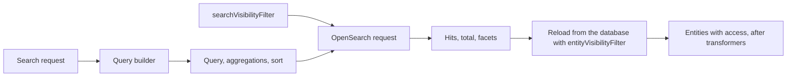

`POST /search` runs a query against an OpenSearch index named `entities`. A query builder writes the query, the
aggregations and the sort. arocapi adds your search visibility filter, runs the search, then loads the matching
entities from the database and returns them in hit order.



## The default query builder

Unless you pass `queryBuilderClass`, arocapi uses `OpensearchQueryBuilder`. It creates one instance at startup, using
`queryBuilderOptions` for its constructor.

### Query

`buildQuery` returns a `bool` query. The text query goes in `must`, so it drives the score. Everything else goes in
`filter`, so it narrows the results without changing the score.

- **`searchType: 'basic'`** (the default) is a `multi_match` over `name` and `description`, with `name` boosted ×2,
  `best_fields` scoring and `fuzziness: 'AUTO'`, so small typos still match. A query with no terms, such as an empty
  string, matches every entity.
- **`searchType: 'advanced'`** is a `query_string` over the same fields with `default_operator: 'AND'`, so users can
  write Lucene syntax (`"exact phrase"`, `name:wordlist`, `a OR b`). A query OpenSearch can't parse returns `422` with
  a `VALIDATION_ERROR` and OpenSearch's message.
- **`filters`** is an object of field names to lists of values. Each field becomes a `terms` filter on the field name
  exactly as given, so values within a field are ORed and fields are ANDed.
- **`boundingBox`** becomes a `geo_bounding_box` filter on `location`.

### Aggregations and facets

By default `buildAggregations` returns a `terms` aggregation of the top 20 values for each of four fields:

| Facet | Aggregates on |
| --- | --- |
| `inLanguage` | `inLanguage.keyword` |
| `mediaType` | `mediaType.keyword` |
| `communicationMode` | `communicationMode.keyword` |
| `entityType` | `entityType.keyword` |

Each aggregation's buckets come back in the response's `facets`, keyed by the aggregation name, as
`{ name, count }` pairs. Aggregations without buckets are left out, and `facets` is omitted when none have any.

If the request has both `geohashPrecision` and `boundingBox`, the builder adds a `geohash_grid` aggregation on
`location`, and the response has a `geohashGrid` map of geohash to count. The name `geohash_grid` is reserved for this.

`GET /capabilities` advertises every `terms` aggregation as both a string filter and a facet, so clients learn the
facet names from it and send them back as `filters`.

### Sort

`buildSort` turns the request's `sort` and `order` into an OpenSearch sort:

| `sort` | Sorts on |
| --- | --- |
| `relevance` (the default) | the score, highest first; `order` is ignored |
| `name` | `name.keyword` |
| `id`, `createdAt`, `updatedAt` | the field of that name |

arocapi also asks OpenSearch to highlight matches in `name` and `description`, and returns the score and highlights in
each entity's `searchExtra`.

### The index mapping it assumes

The builder doesn't create the index, so your mapping has to match the fields it uses:

- `_source.id` holds the entity's ID. arocapi uses it to load the entity from the database.
- `name` and `description` are `text`, and `name` has a `keyword` subfield for sorting by name.
- `id`, `createdAt` and `updatedAt` are sortable (`keyword` and `date`) if clients sort by them.
- `location` is a `geo_point` if you use bounding boxes or the geohash grid.

The facet fields need care, because the default aggregations and filters assume different mappings. The aggregations
read a `.keyword` subfield, which is what OpenSearch's dynamic mapping creates for a string: a `text` field with a
`keyword` subfield. Filters, though, use the bare field name, and a `terms` filter on a `text` field compares against
analysed tokens, so a value such as `http://pcdm.org/models#Collection` won't match. If you map the facet fields as
`keyword` instead, filters match exactly but the default aggregations find no `.keyword` subfield and return no
facets.

So pick one mapping and make the other side agree. The simplest is to map each facet field as `keyword`, and pass
aggregations on the bare field names:

```ts twoslash
import type { QueryBuilderOptions } from 'arocapi';

const fields = ['inLanguage', 'mediaType', 'communicationMode', 'entityType'];

export const queryBuilderOptions: QueryBuilderOptions = {
  aggregations: Object.fromEntries(fields.map((field) => [field, { terms: { field, size: 20 } }])),
};
```

Passing `aggregations` replaces the defaults rather than adding to them, so list every facet you want.

Alternatively, keep the default aggregations and map each facet field as `keyword` with a `keyword` subfield of its
own, so both sides match exactly. The mapping on [OpenSearch](/getting-started/opensearch/) does this.

## Search and visibility

Your `searchVisibilityFilter` returns an OpenSearch query. arocapi puts it in the search's `filter` clause beside the
query builder's query, so a custom query builder can't leave it out. Hidden entities are therefore excluded from the
hits, from `total` and from every facet count.

arocapi then loads the hits from the database through your `entityVisibilityFilter` as well. A hit that the database
filter hides, or that isn't in the database, is dropped from the page with a warning in the log. `total` and the facets
come from OpenSearch, so they still count it.

Keep the two filters in step: whatever field `entityVisibilityFilter` checks in the database has to be indexed, and
`searchVisibilityFilter` checks the same thing in the index. For example, if drafts are hidden through a `draft` flag
in the entity's `meta`, index that flag too (see
[why the two filters must agree](/concepts/visibility-vs-access/#why-the-two-filters-must-agree)):

```ts twoslash
import type { SearchVisibilityFilter } from 'arocapi';

export const searchVisibilityFilter: SearchVisibilityFilter = () => ({
  bool: { must_not: [{ term: { draft: true } }] },
});
```

## Customising the query builder

To change how queries are built, subclass `OpensearchQueryBuilder`, override the methods you need, and pass the class
as `queryBuilderClass`. Each method can call `super` and adjust the result.

| Method | Called for | Returns |
| --- | --- | --- |
| `buildQuery(searchType, query, filters?, boundingBox?)` | every search | the query, placed in `must` |
| `buildAggregations(geohashPrecision?, boundingBox?)` | every search | the `aggs` object |
| `buildSort(sort, order)` | every search | the `sort` array, or `undefined` for score order |
| `searchCapabilities()` | `GET /capabilities` | the advertised filters and facets |

This builder ranks collections above the items in them, breaks ties in sorted results by ID, and labels its facets:

```ts twoslash
import { OpensearchQueryBuilder, type Options } from 'arocapi';

class ArchiveQueryBuilder extends OpensearchQueryBuilder {
  override buildQuery(...args: Parameters<OpensearchQueryBuilder['buildQuery']>) {
    const { bool } = super.buildQuery(...args);

    return {
      bool: {
        ...bool,
        should: [{ term: { entityType: { value: 'http://pcdm.org/models#Collection', boost: 2 } } }],
      },
    };
  }

  override buildSort(...args: Parameters<OpensearchQueryBuilder['buildSort']>) {
    const sort = super.buildSort(...args);

    return sort && [...sort, { id: 'asc' as const }];
  }

  override searchCapabilities() {
    const capabilities = super.searchCapabilities();
    capabilities.facets.entityType = { label: 'Type' };
    capabilities.facets.inLanguage = { label: 'Language' };

    return capabilities;
  }
}

export const searchOptions: Pick<Options, 'queryBuilderClass' | 'queryBuilderOptions'> = {
  queryBuilderClass: ArchiveQueryBuilder,
};
```

A `should` clause beside `must` only adds to the score, so collections rise without anything being excluded.

The request body is validated before the builder sees it: `sort` is one of `id`, `name`, `createdAt`, `updatedAt` or
`relevance`, and `searchType` is `basic` or `advanced`. A subclass can change what those values mean, but not add new
ones.

The options are under [Search](/configuration/search/), and the request body and response under
[`POST /search`](/reference/routes/#post-search).
