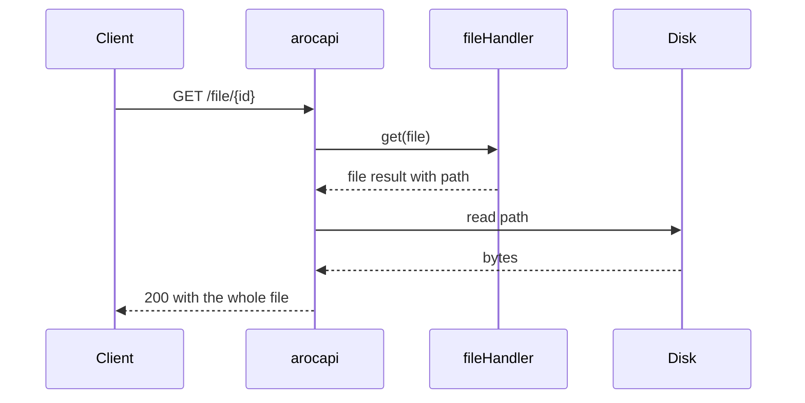
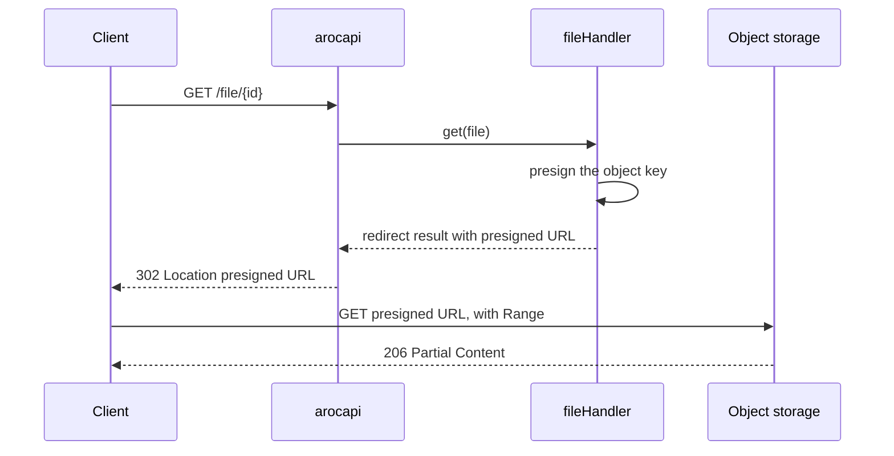
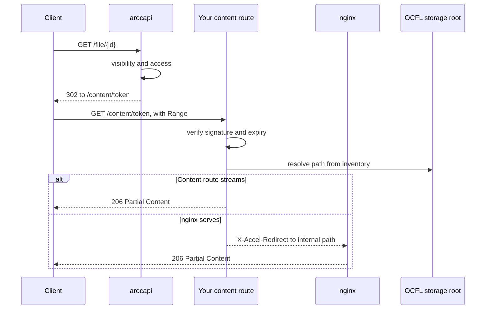

import { Code } from '@astrojs/starlight/components';
import storageLocal from '../../../../examples/strategies/storage-local.ts?raw';
import storageAccel from '../../../../examples/strategies/storage-accel.ts?raw';
import storagePresigned from '../../../../examples/strategies/storage-presigned.ts?raw';
import storageSignedUrl from '../../../../examples/strategies/storage-signed-url.ts?raw';
import storageRoCrate from '../../../../examples/strategies/storage-ro-crate.ts?raw';

arocapi doesn't know where your files live. Two handlers fetch them for it:

- `fileHandler` serves a file's content on `GET` and `HEAD /file/:id`. It receives the File row, including the file's
  own `meta` column.
- `roCrateHandler` serves an entity's RO-Crate metadata on `GET` and `HEAD /entity/:id/metadata`. It receives the
  Entity row, including the entity's `meta` column.

Both run only after the entity is visible and the request may read it (see
[Visibility vs Access](/concepts/visibility-vs-access/) and the
[request lifecycle](/concepts/request-lifecycle/#metadata-and-content-routes)), so a handler never checks access
itself. Each has a `get`, which returns how to deliver the bytes, and a `head`, which returns only their headers.
Either can return `false` to answer 404. The full contract is under [Handlers](/configuration/handlers/), and the `meta` columns under
[Entity meta](/reference/entity-meta/).

## Stream or redirect

`get` returns one of three results:

| Result | What arocapi sends |
| --- | --- |
| `{ type: 'redirect', url }` | `302` to `url`. On `/file/:id`, `?noRedirect=true` returns `200` with `{ "location": url }` instead. |
| `{ type: 'stream', stream, metadata }` | `200` with the stream as the body. |
| `{ type: 'file', path, metadata, accelPath? }` | `200` with the file at `path` read from disk, or an empty body and an `X-Accel-Redirect: accelPath` header for nginx to fill. |

For `stream` and `file`, arocapi sets `Content-Type`, `Content-Length`, `ETag` and `Last-Modified` from `metadata`. On
`/file/:id` it also sets `Content-Disposition` from the `disposition` and `filename` query parameters. On
`/entity/:id/metadata` it always sends `Content-Type: application/ld+json`, whatever `metadata.contentType` says.

Which result you return decides who moves the bytes and what the client can do with them:

- **Streaming** keeps every byte behind your API: one origin, no URLs to leak, and nothing extra to configure for
  CORS. But your Node process carries the whole transfer.
- **Redirecting** hands the transfer to something built for it, such as object storage, a CDN or nginx. The cost is a
  second request, a second origin that browsers must be allowed to read from, and a URL that works for anyone who holds
  it until it expires.

### Range requests

Audio and video players seek by asking for byte ranges (`Range: bytes=…`) and expect `206 Partial Content` back.
**arocapi doesn't handle ranges.** It ignores the `Range` header and answers a `stream` or `file` result with `200`,
the whole body and the full `Content-Length`. Your handler can read the request through its context, but it can't
change the status or add a `Content-Range`, so a stream that returns only part of a file would not match the headers
arocapi sends.

To give players range support, let something else serve the bytes:

- a `redirect` to a server that handles ranges, such as object storage or your own content route; or
- a `file` result with `accelPath`, so nginx serves the file and handles the range itself.

A client that wants the redirect target without following it can call `/file/:id?noRedirect=true`. Any non-empty value
counts as true, so `?noRedirect=false` also returns the JSON. Leave the parameter out to get the redirect.

### HEAD requests

`head` returns only the `metadata`, and arocapi answers `200` with those headers whatever `get` would return. For a
redirect pattern that means `head` still needs the size and type. Take them from the File row (`mediaType` and `size`)
rather than asking storage on every request.

## Stream from local disk

The simplest pattern: files sit on a disk the API server can read, and arocapi streams them.

Store each file's location in its `meta` column when you index it, then build the path from it.

<Code code={storageLocal} lang="ts" />

Use this when files are small, or when nobody needs to seek within them. It is a poor fit for media playback, because
every seek downloads the file from the start. If nginx sits in front of arocapi, add `accelPath` to the same result and
nginx serves the file, with range support, from an `internal` location:

<Code code={storageAccel} lang="ts" />

## Redirect to object storage

Files live in an S3-compatible bucket that is not public. The handler signs a short-lived URL for the object and
redirects to it, and the bucket serves the bytes, ranges included.

<Code code={storagePresigned} lang="ts" />

Things to plan for:

- **Keep the expiry short.** arocapi checks access before it calls the handler, so the presigned URL is the
  permission. Anyone holding it can download the file until it expires.
- **Pass on the download name.** arocapi only sets `Content-Disposition` on bytes it serves itself. For a redirect, ask
  the bucket to set it, as above, or `?disposition=attachment` has no effect.
- **Allow your web clients in the bucket's CORS rules** if they fetch content from the browser. A client that can't
  follow a cross-origin redirect can call `/file/:id?noRedirect=true` and fetch the returned `location` itself.

## OCFL behind a signed redirect

Files are preserved in an [OCFL](https://ocfl.io) storage root, where a file's path on disk depends on the object's
inventory and version. Rather than resolve that inside arocapi and stream the result without ranges, the handler
redirects to a content route of your own. That route is not part of arocapi.

1. `fileHandler.get` signs a token naming the file, valid for a short time, and returns a redirect to
   `/content/<token>`.
2. The content route checks the signature and expiry, resolves the file's path through the OCFL inventory, and serves
   it in one of two ways:
   - it streams the file itself and handles `Range` (for example with Fastify's static file support); or
   - it replies with `X-Accel-Redirect` and lets nginx serve the file from an `internal` location.

arocapi's part is only the signing:

<Code code={storageSignedUrl} lang="ts" />

The token stands in for the access check that arocapi already made, so the content route must trust nothing else in
the request. Keep the expiry short, and scope the token to one file.

This pattern suits archives that already keep OCFL: the storage root stays the source of truth, arocapi stays out of
the byte path, and media seeks work. The cost is a second route and a signing key to look after.

## RO-Crate metadata

`roCrateHandler` follows the same contract, with the Entity row in place of the File row. Two differences from files:

- Metadata documents are small and are read whole, so streaming them is usually fine and range requests don't
  matter.
- arocapi sets `Content-Type: application/ld+json` itself and sends no `Content-Disposition`. A redirect is a plain
  `302`. `/entity/:id/metadata` has no `noRedirect` option.

The same storage patterns apply: read `ro-crate-metadata.json` from disk, redirect to it in object storage, or resolve
it from the OCFL object. Because the handler can return a stream, it can also build the document on the fly, for
example to redact it before sending it.

<Code code={storageRoCrate} lang="ts" />

`contentLength` must match the bytes you send, so measure a generated document after you build it.
